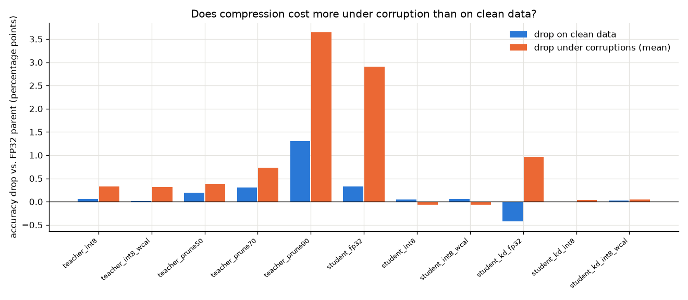

# Traffic sign recognition after compression, in clear and bad weather

## Motivation
The networks that run in cars are usually compressed, and compressed models are mostly judged on a clean test set. A sign classifier that loses half a point on sunny images could lose a lot more in fog. The question comes from automotive validation, where a model is only accepted after it passes tests under realistic conditions.

This project tests whether clean accuracy is a sufficient acceptance criterion for compressed perception models. The answer is mixed. Clean accuracy hid the cost of heavy pruning and the weaker bad-weather behaviour of the distilled student. For INT8 it was a fair guide, once INT8 ran correctly on the test CPU.

## Method
The project trains a ResNet-18 teacher (ImageNet weights, max-pool removed) and a 0.29 M-parameter CNN student on GTSRB at 64x64, with validation split by track so near-duplicate frames don't leak.

From these come 12 variants: INT8 versions of the teacher, the student and a distilled student (ONNX Runtime static quantization, per-channel), the teacher pruned to 50, 70 and 90% with global L1 pruning and short fine-tuning, and the distilled student itself (T=4, alpha=0.7). Each INT8 model also has a weather-aware version, calibrated on images where half had fog, rain or low light.

Every variant runs on the 12,630 clean test images and on 30 corrupted copies (six corruptions at five severities, generated by seeded NumPy and OpenCV code in `src/corruptions.py`). The evaluation covers accuracy, the flip rate (how often a prediction differs from the FP32 parent), calibration error, and single-thread CPU latency in ONNX Runtime.

## Results


- At 90% sparsity the pruned teacher loses about 1.3 points on clean images and about 3.7 under corruption, almost 3x as much. Its predictions change for a fifth of the corrupted images.
- The distilled student beats the teacher on clean data by about 0.4 points and falls about 1 point behind it under corruption. Its INT8 version is about 140x smaller and 6x faster than the teacher.
- Correct INT8 costs at most about 0.3 points on average, but the INT8 teacher still changes its answer on about 3% of corrupted images.
- Clean and corrupted accuracy rank the variants differently (Spearman 0.55), though many variants are too close for this to be firm.
- Weather-aware calibration made no measurable difference, on seen or held-out corruptions.

Losses are given in percentage points. As a relative error the pruning result turns around (about 1.8x the parent's errors clean, 1.2x corrupted), because the corrupted error rate is already high. For safety the absolute view is more useful, since it counts extra failures.

Under corruption the teacher also becomes overconfident: its calibration error rises from about 0.003 to about 0.1, so its confidence score gives no warning in bad weather.

| variant | size MB | latency ms | clean % | corrupted % | flip corr % |
|---|---|---|---|---|---|
| teacher_fp32 | 44.78 | 12.35 | 98.27 | 78.32 | - |
| teacher_int8 | 11.32 | 6.59 | 98.21 | 78.00 | 3.1 |
| teacher_int8_wcal | 11.32 | 6.58 | 98.26 | 78.01 | 3.0 |
| teacher_prune50 | 44.78 | 12.22 | 98.08 | 77.94 | 6.5 |
| teacher_prune70 | 44.78 | 12.23 | 97.97 | 77.59 | 11.7 |
| teacher_prune90 | 44.78 | 12.24 | 96.98 | 74.68 | 19.5 |
| student_fp32 | 1.17 | 2.84 | 97.94 | 75.42 | 26.3 |
| student_int8 | 0.32 | 1.94 | 97.89 | 75.48 | 4.1 |
| student_int8_wcal | 0.32 | 1.94 | 97.89 | 75.48 | 4.0 |
| student_kd_fp32 | 1.17 | 2.84 | 98.70 | 77.36 | 24.9 |
| student_kd_int8 | 0.32 | 1.94 | 98.71 | 77.32 | 3.2 |
| student_kd_int8_wcal | 0.32 | 1.94 | 98.68 | 77.32 | 3.2 |

Corrupted accuracy is the mean over the 30 corrupted sets. For the two FP32 students the parent is the teacher, so their flip rate includes the change of architecture, not only compression. Unstructured pruning leaves the dense file and latency unchanged; only the gzip size shrinks. The full table is in `results/results.csv` and more figures are in `results/figures/`.

## What went wrong along the way
The first teacher reached only 96.9%, and the small student beat it. ResNet-18 shrinks its input 4x before the first block, so a 64x64 image became 16x16 feature maps. Removing the max-pool layer raised the teacher to 98.27% at about twice the latency, and everything downstream was re-run (the numbers of the first run are in `docs/EXPERIMENT_LOG.md`).

The first INT8 students lost about 4 points on clean data and up to 35 in heavy fog. Rounding in the first layer looked like the cause, but simulated 8-bit rounding was harmless, while running the same file unfused fixed it. The ONNX Runtime documentation explained why: on a CPU with AVX2 and no VNNI, the default U8S8 kernel adds pairs of products in 16 bits, and those sums can saturate. With `reduce_range=True` the sums fit, and the INT8 student went from 94.2% to 97.9% at the same speed. So a compressed model has to be checked on the stack it will run on.

## Limitations
The corruptions are synthetic, the images small, and the task is classifying cropped signs. Detection in full scenes was not tested. Each model was trained once, so differences below about 0.3 points are noise. All results come from one CPU and one inference engine, without hyper-parameter tuning.

## Next steps
Structured pruning would give real speed-ups, and the same study could be repeated on object detection.
Testing on embedded hardware would show whether the INT8 findings carry over.

## Running it
```
python -m venv .venv
.venv/bin/pip install -r requirements.txt   # use the CPU wheel index for torch
# place GTSRB under data/gtsrb/ (torchvision.datasets.GTSRB layout)
scripts/run_all.sh                           # about 5 to 8 hours on a 6-core CPU; every step is resumable
.venv/bin/python -m unittest                 # quick tests; RUN_SLOW=1 for the slow ones
```
All tunable numbers are in `src/config.py`. Steps, timings and checks are in `docs/EXPERIMENT_LOG.md`.

## Credits
- GTSRB: J. Stallkamp, M. Schlipsing, J. Salmen, C. Igel, "Man vs. computer: Benchmarking machine learning algorithms for traffic sign recognition", Neural Networks, 2012. The dataset is not redistributed here; it is downloaded through `torchvision.datasets.GTSRB`.
- The teacher starts from torchvision's ImageNet-pretrained ResNet-18 weights (K. He et al., "Deep Residual Learning for Image Recognition", CVPR 2016).
- S. Hooker et al., "What Do Compressed Deep Neural Networks Forget?", 2019.
- D. Hendrycks, T. Dietterich, "Benchmarking Neural Network Robustness to Common Corruptions and Perturbations", ICLR 2019.
- G. Hinton, O. Vinyals, J. Dean, "Distilling the Knowledge in a Neural Network", 2015.
- ONNX Runtime, [Quantize ONNX models](https://onnxruntime.ai/docs/performance/model-optimizations/quantization.html), section "Data type selection".

The code is released under the MIT License (see `LICENSE`).
